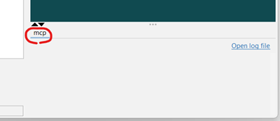
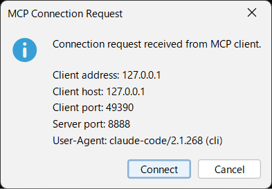

# Astah Pro MCP: Enabling AI-Powered UML Modeling

A local MCP server plugin for Astah Professional, a UML modeling tool, that enables AI agents to:

- Design systems and represent them as UML models.
- Explain UML models.
- Generate source code from UML models, and vice versa.
- Create UML diagrams from hand-drawn sketches.

## Demo

Topic: **Vending machine**  
Setup: Astah Pro **v12.0** / Astah Pro MCP **v0.3.7**

Prompts:
- **I.** *Design a simple beverage vending machine system and draw a class diagram in Astah to illustrate its structure. The system should support cash purchases by customers, product restocking by operators, and inventory management.*
- **II.** *Based on the contents of the Astah model, draw a sequence diagram to illustrate the behavior of purchasing a beverage with cash.*
- **III.** *Based on the contents of the Astah model, draw an activity diagram to illustrate the behavior of restocking beverages in the vending machine.*
- **IV.** *Based on the contents of the Astah model, draw a state machine diagram to illustrate the state transitions of the vending machine during operation.*

### Claude Code

**Opus 5.5 (high effort)** / Total time: **17.6 min**

<table width="100%">
  <tr>
    <td width="25%" align="center"><b>I</b></td>
    <td width="25%" align="center"><b>II</b></td>
    <td width="25%" align="center"><b>III</b></td>
    <td width="25%" align="center"><b>IV</b></td>
  </tr>
  <tr>
    <td width="25%"><a href="demo/claude-code/VendingMachine%20Class%20Diagram.png"></a></td>
    <td width="25%"><a href="demo/claude-code/Purchase%20Beverage%20With%20Cash.png"></a></td>
    <td width="25%"><a href="demo/claude-code/Restock%20Beverages.png"></a></td>
    <td width="25%"><a href="demo/claude-code/VendingMachine%20State%20Machine.png"></a></td>
  </tr>
</table>

### Antigravity CLI

**Gemini 4 Carbon (high effort)** / Total time: **86.3 min**

<table width="100%">
  <tr>
    <td width="25%" align="center"><b>I</b></td>
    <td width="25%" align="center"><b>II</b></td>
    <td width="25%" align="center"><b>III</b></td>
    <td width="25%" align="center"><b>IV</b></td>
  </tr>
  <tr>
    <td width="25%"><a href="demo/antigravity-cli/Beverage%20Vending%20Machine%20Structure.png"></a></td>
    <td width="25%"><a href="demo/antigravity-cli/Cash%20Beverage%20Purchase.png"></a></td>
    <td width="25%"><a href="demo/antigravity-cli/Beverage%20Restocking.png"></a></td>
    <td width="25%"><a href="demo/antigravity-cli/Vending%20Machine%20Operation.png"></a></td>
  </tr>
</table>

### Codex CLI

**GPT 6 Astra (high effort)** / Total time: **12.2 min**

<table width="100%">
  <tr>
    <td width="25%" align="center"><b>I</b></td>
    <td width="25%" align="center"><b>II</b></td>
    <td width="25%" align="center"><b>III</b></td>
    <td width="25%" align="center"><b>IV</b></td>
  </tr>
  <tr>
    <td width="25%"><a href="demo/codex-cli/01%20-%20Vending%20Machine%20Structure.png"></a></td>
    <td width="25%"><a href="demo/codex-cli/02%20-%20Cash%20Purchase.png"></a></td>
    <td width="25%"><a href="demo/codex-cli/03%20-%20Beverage%20Restocking.png"></a></td>
    <td width="25%"><a href="demo/codex-cli/04%20-%20Vending%20Machine%20Operation.png"></a></td>
  </tr>
</table>

> *Notes (from personal experience):*
> - With Codex CLI, GPT 6 Astra > GPT 6.2 Astra for UML modeling.
> - Across all AI agents, it is better to set Effort to High or above.

## Requirements

- **AI agent**

  The AI agents below have been tested, but no guarantee is implied. From personal experience, **Claude Code** works well for UML modeling.

  - Claude Code
  - Antigravity CLI
  - Codex CLI
  - Antigravity IDE
  - Kiro IDE

- **Astah Pro v12.0 or later**

  > *Note:* This MCP server only connects to AI agents running on the same machine as Astah Professional.
  According to Astah's terms of use, using Astah via an AI agent is permitted only if you hold a valid license and access it exclusively for your own use with your licensed Astah. Allowing a non-licensed third party to operate Astah via such an agent is strictly prohibited.  
  For details, please refer to the FAQ ([English](https://astah.net/support/cv-members-guide/#ai-external-access) / [Japanese](https://astah.change-vision.com/ja/faq/faq-license/ai-external-access.html)) or [contact Change Vision (the developer of Astah)](https://astah.net/about/contact/) directly.

## Supported Diagram Types

- **Class Diagram**  
- **Sequence Diagram**  
- **Activity Diagram**
- **State Machine Diagram**
- **Use Case Diagram**
- **Mind Map**
- **Requirement Diagram**
- **Composite Structure Diagram** (with some limitations)
- **Communication Diagram** (query-only)
- **ER Diagram** (query-only)

## Installation

### Install Astah Pro

Download from [here](https://astah.net/downloads/) and install.

### Install the Astah Pro MCP plugin

Download [the plugin JAR file (astah-pro-mcp-x.x.x.jar)](https://github.com/takaakit/astah-pro-mcp/releases), drop it into Astah, and restart Astah (see [here](https://astahblog.com/2014/12/15/astah_plugins/)). If the `mcp` tab appears in the Extra View, the plugin is installed.



### AI agent settings

This plugin experimentally implements a programmatic tool calling mode (port `8888`), inspired by the **"Programmatic Tool Calling"** idea described in [this Anthropic article](https://www.anthropic.com/engineering/advanced-tool-use). The direct tool calling mode also remains available (port `18888`). Unless you have a specific reason to choose otherwise, specify port `8888`.

| Mode | Port | Exposed tools |
| --- | --- | --- |
| Programmatic tool calling | `8888` | 75 |
| Direct tool calling | `18888` | 382 |

<details>
<summary><b>Claude Code</b></summary>

Run this command for project scope in your project directory:
```bash
claude mcp add --transport http --scope project astah-pro-mcp http://127.0.0.1:8888/mcp
```

Or run this command for user scope:
```bash
claude mcp add --transport http --scope user astah-pro-mcp http://127.0.0.1:8888/mcp
```

</details>


<details>
<summary><b>Antigravity CLI</b></summary>

Create `.agents/mcp_config.json` under your project directory (workspace scope) or edit `~/.gemini/config/mcp_config.json` (global scope) with:

```json
{
  "mcpServers": {
    "apm": {
      "serverUrl": "http://127.0.0.1:8888/mcp"
    }
  }
}
```

> The server key is shortened to `apm` to keep tool names within Antigravity's 64-character limit.

</details>


<details>
<summary><b>Codex CLI</b></summary>

Create `.codex/config.toml` under your project directory or your user directory with:

```toml
[mcp_servers.astah-pro-mcp]
transport = "http"
url = "http://127.0.0.1:8888/mcp"
```

</details>


<details>
<summary><b>Antigravity IDE</b></summary>

```json
{
  "mcpServers": {
    "apm": {
      "command": "npx",
      "args": [
        "-y",
        "mcp-remote",
        "http://127.0.0.1:8888/mcp",
        "--allow-http"
      ]
    }
  }
}
```

> Use [mcp-remote](https://github.com/geelen/mcp-remote) to bridge the HTTP connection. [Node.js](https://nodejs.org/) must be installed.

> The server key is shortened to `apm` to keep tool names within Antigravity's 64-character limit.

</details>


<details>
<summary><b>Kiro IDE</b></summary>

```json
{
  "mcpServers": {
    "astah-pro-mcp": {
      "command": "npx",
      "args": [
        "-y",
        "mcp-remote",
        "http://127.0.0.1:8888/mcp",
        "--allow-http"
      ]
    }
  }
}
```

> Use [mcp-remote](https://github.com/geelen/mcp-remote) to bridge the HTTP connection. [Node.js](https://nodejs.org/) must be installed.

</details>


## Changing the Port Numbers

By default, the plugin listens on `8888` (programmatic tool calling mode) and `18888` (direct tool calling mode). Each port can be overridden with an environment variable:

| Mode | Environment variable |
| --- | --- |
| Programmatic tool calling | `ASTAH_PRO_MCP_PORT_FOR_PROGRAMMATIC` |
| Direct tool calling | `ASTAH_PRO_MCP_PORT_FOR_DIRECT` |

Remember to update your AI agent settings to the same port numbers.

## How to Use

1. Start Astah Pro

   Some AI agents try to connect to the MCP server on startup, so start Astah Pro **first**.

2. Start AI agents

   Each time an AI agent establishes a new session with the Astah Pro MCP server, you will be asked to confirm. Review the details and click **'Connect'**.  
  

3. Send prompts to the AI agents

If you want to disable the Astah Pro MCP plugin in Astah, click [Plugin] > [Installed Plugins], select the *Astah Pro MCP* entry in the plugin list dialog, click Disable, and then restart Astah.

## Build & Test

If you want to build and test locally:

1. Set up your Astah plugin development environment (see [here](https://astah.net/support/plugin-dev-tutorial/plugin-development-setup-for-astah-professional/)).

2. Build:
   ```bash
   astah-build
   ```

3. Run tests (change `astahPath` to your Astah Pro installation path):

   Run all tests on Windows 11:
   ```bash
   astah-mvn test -DastahPath="C:\Program Files\astah-professional"
   ```

   Run specific tests on Windows 11:
   ```bash
   astah-mvn test -DastahPath="C:\Program Files\astah-professional" -Dtest="**/editor/*Test"
   ```

## Considerations

### Experimental Status
This project is currently experimental. The design and implementation may undergo breaking changes.

### Confidentiality Risk
Astah project data and logs will be shared with the AI agent. For Astah projects that contain confidential information, either refrain from using this MCP server or use it only with appropriate safeguards (e.g., enabling opt-out settings for AI agents).

### Backups Recommended
Because this MCP server edits model elements and diagrams, we recommend committing your Astah project to a Git repository or making copies before and during use so you can revert if necessary.

### Feature Limitations
Some model or diagram information (e.g., certain properties) cannot be viewed or edited via the provided tool functions. Use the Astah GUI directly for those.

### Costs
This MCP server prioritizes providing the information AI agents need and does **not** implement token-saving measures. We recommend using AI agents on a **flat-rate** plan rather than pay-as-you-go.

### AI Limitations
Just as when working with source code, AI agents can make mistakes or misinterpret model elements and diagrams.

## License

Some tool functions provided by this MCP server return excerpts from the [OMG UML 2.5.1](https://www.omg.org/spec/UML/2.5.1/PDF) and [OMG SysML 1.7](https://www.omg.org/spec/SysML/1.7/PDF) specifications and from [FIPS PUB 184 IDEF1X](https://www.govinfo.gov/app/details/GOVPUB-C13-986bf8b12a4fed44eb78fca0bb55d668). The OMG UML/SysML specifications are licensed as stated at the beginning of each document. FIPS PUB 184 IDEF1X is a U.S. Government work (NIST) and is not subject to copyright protection in the United States (17 U.S.C. §105), but may be subject to foreign copyright. When content from these specifications/documents is returned by tool functions, it is explicitly indicated as an excerpt. "Mind Map" is a registered trademark of The Buzan Organisation Limited.

One tool function returns UML diagram consistency rules quoted from the papers below. Copyright of these rule statements remains with their authors and publishers; they are quoted with attribution and explicitly indicated as excerpts.
- Torre, Damiano, et al. "A systematic identification of consistency rules for UML diagrams." Journal of Systems and Software 144 (2018): 121-142.
- Torre, Damiano, et al. "How consistency is handled in model-driven software engineering and UML: an expert opinion survey." Software Quality Journal 31.1 (2023): 1-54.

All other works, including source code, are copyrighted by **Takaaki Teshima** and released under the **MIT-0** license.  
[](https://opensource.org/licenses/MIT-0)

## Disclaimer

This project is developed independently by the authors in their personal capacities and is not affiliated with any university, institution, or employer.

## Got a feature request or found a bug?

Please open an [issue](https://github.com/takaakit/astah-pro-mcp/issues). Because this project is in an experimental phase and may introduce breaking changes, we aren't accepting pull requests until the design and implementation stabilize. Thank you for your understanding.

## Need support?

If you need private support, contact `takaaki.teshima.dev [at] gmail.com` (replace `[at]` with `@`). It could become a paid project; I may still be able to support you/it.
